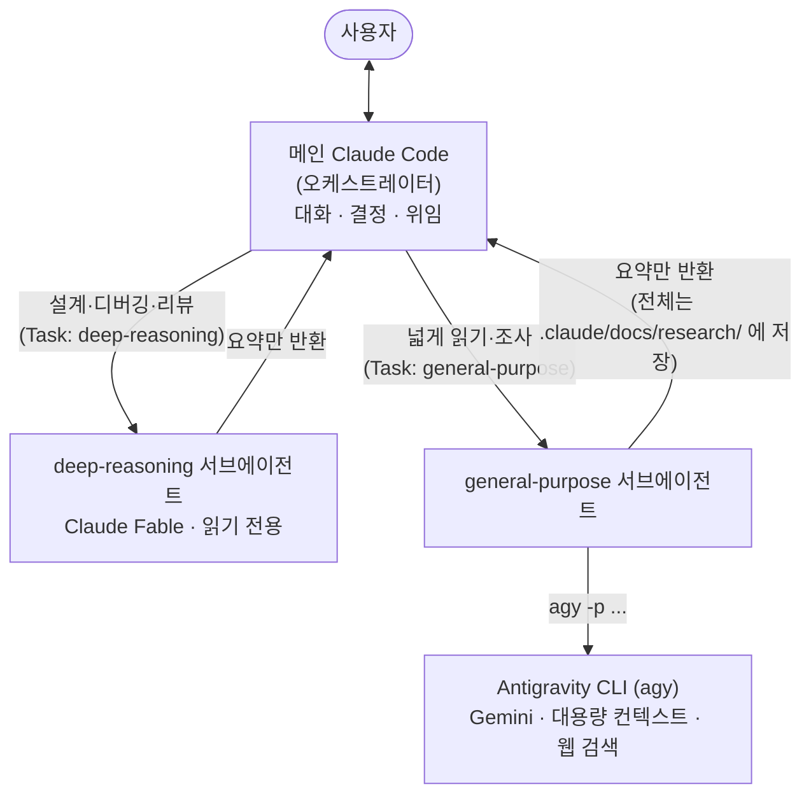
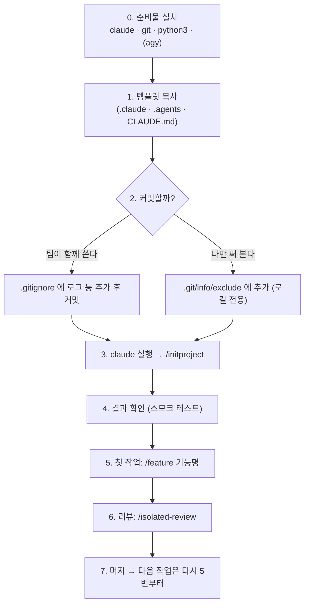
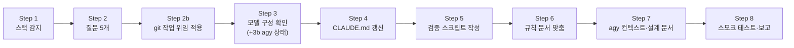
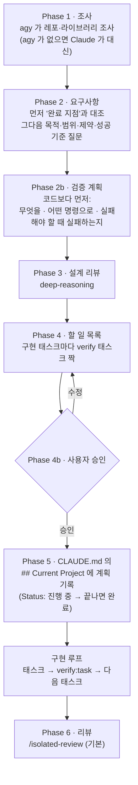
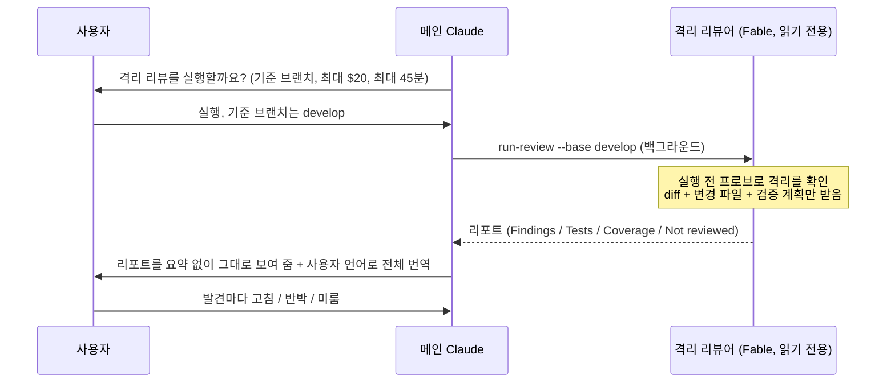

# claude-code-orchestrator

**Claude Code 를 "오케스트레이터"로 쓰게 해 주는 프로젝트 템플릿.**
메인 Claude 는 사용자와 대화하고 결정만 하고, 실제 일은 전문 서브에이전트에게 맡긴다.


> 현재 버전: **5.0.0** — 변경 내역은 [`CHANGELOG.md`](CHANGELOG.md). 4.x 에서 올린다면
> [5.0.0 으로 올릴 때](#500-으로-올릴-때)를 먼저 본다.

## 목차

1. [이게 뭔가요?](#1-이게-뭔가요)
2. [어떻게 동작하나요? (구조)](#2-어떻게-동작하나요-구조)
3. [무엇이 들어 있나요?](#3-무엇이-들어-있나요)
4. [준비물](#4-준비물)
5. [**프로젝트에 적용하기 — 처음부터 끝까지**](#5-프로젝트에-적용하기--처음부터-끝까지)
6. [매일 쓰는 법 — `/feature` 한 바퀴](#6-매일-쓰는-법--feature-한-바퀴)
7. [리뷰 받기 — `/isolated-review`](#7-리뷰-받기--isolated-review)
8. [검증 계약 — `verify-*` 스크립트](#8-검증-계약--verify--스크립트)
9. [버전 확인과 업그레이드](#9-버전-확인과-업그레이드)
10. [자주 밟는 함정](#10-자주-밟는-함정)
11. [지금 무엇이 검증됐나](#11-지금-무엇이-검증됐나)
12. [이 저장소를 개발하는 사람에게](#12-이-저장소를-개발하는-사람에게)

---

## 1. 이게 뭔가요?

Claude Code 에게 큰 일을 맡기면 금방 **컨텍스트(작업 기억)** 가 찬다. 파일을 많이 읽고, 긴 로그를 보고,
설계를 고민하다 보면 정작 중요한 대화 내용이 밀려난다.

이 템플릿은 그 문제를 **역할 분담**으로 푼다.

| 역할 | 누가 | 하는 일 |
|---|---|---|
| **오케스트레이터** (팀장) | 메인 Claude Code | 사용자와 대화, 할 일 정리, 누구에게 맡길지 결정, 최종 판단 |
| **깊은 추론** (설계 전문가) | `deep-reasoning` 서브에이전트 (Claude Fable) | 설계 검토, 디버깅, 트레이드오프 비교, 코드 리뷰 — **읽기만 한다** |
| **넓게 읽기** (조사 담당) | `general-purpose` 서브에이전트 → **Antigravity CLI (`agy`, Gemini)** | 레포 전체 분석, 라이브러리·웹 조사, PDF·이미지 분석, 긴 출력 요약 |

서브에이전트는 **자기만의 컨텍스트**에서 일하고 **요약만** 돌려준다. 그래서 메인 Claude 의 기억은
가볍게 유지되고, 각자 잘하는 일을 한다.

> **이 템플릿의 판단 기준은 하나다.** 무언가를 더하거나 고칠 때 "위임·컨텍스트 절약·결과 품질 중
> 하나를 낫게 하는가?" 아니면 넣지 않는다. (`CLAUDE.md` 맨 앞에도 같은 문장이 있다.)

### 먼저 알아 둘 용어

| 용어 | 뜻 |
|---|---|
| **컨텍스트** | Claude 가 한 세션에서 기억하는 내용 전체. 읽은 파일·출력·대화가 모두 쌓이고, 가득 차면 앞부분이 요약되며 흐려진다 |
| **서브에이전트** | 메인 Claude 가 일을 맡기는 별도의 Claude. 자기 컨텍스트에서 일하고 요약만 돌려준다 |
| **스킬 (슬래시 커맨드)** | `/feature` 처럼 입력하면 정해진 절차가 시작되는 명령. `.claude/skills/` 에 있다 |
| **훅** | Claude 가 파일을 고치거나 명령을 실행할 때 자동으로 도는 작은 스크립트. `.claude/hooks/` 에 있다 |
| **검증 스크립트** | `.claude/scripts/verify-*`. 프로젝트가 건강한지 확인하는 명령을 담고, 종료 코드 0 이면 통과다 |
| **agy** | Google 의 Antigravity CLI(Gemini). 많은 양을 싸게 읽는 일에 쓴다 |
| **`CLAUDE.md`** | 매 세션 자동으로 읽히는 규칙 파일. 프로젝트 설정(`## Project Setup`)도 여기에 기록된다 |

---

## 2. 어떻게 동작하나요? (구조)



### 누구에게 시킬지는 "주제"가 아니라 "비용"으로 정한다

| | 생각할 게 적다 | 생각할 게 많다 |
|---|---|---|
| **읽을 게 많다** | **agy** — 로그 요약, "이 함수 쓰는 곳 전부", 큰 파일에서 관련 부분 찾기 | **agy 가 범위를 좁히고 → deep-reasoning 이 판단** |
| **읽을 게 적다** | **메인 Claude 가 직접** | **deep-reasoning** |

**판단은 절대 agy 에게 넘기지 않는다.** agy 는 "어디에 무엇이 있다(`file:line`)"만 알려 주고,
"그게 버그인지·설계가 맞는지"는 Claude 가 정한다.

**"큰 변경"의 기준:** 파일 5개 또는 500줄. 이걸 넘으면 deep-reasoning 앞에 agy 를 두어 범위를 좁힌다.
(보안 경계나 공개 인터페이스를 바꾸는 변경은 크기와 상관없이 항상 "크다".)

### 컨텍스트를 지키는 규칙

| 결과물 크기 | 방법 |
|---|---|
| 1~2문장 | 메인이 직접 |
| 10줄 이상 | 서브에이전트를 거친다 |
| 분석 리포트 | 서브에이전트가 `.claude/docs/` 에 저장하고 요약만 돌려준다 |

---

## 3. 무엇이 들어 있나요?

프로젝트에 복사되는 것은 **`.claude/`, `.agents/`, `CLAUDE.md`** 세 가지뿐이다.

```text
your-project/
├── CLAUDE.md                      # 매 세션 자동으로 읽히는 규칙 (목적·위임·검증·운영 주의)
├── .agents/
│   └── rules/AGENTS.md            # agy 가 읽는 프로젝트 설명
└── .claude/
    ├── ORCHESTRATOR_VERSION       # 이 사본이 어느 릴리스인지 (예: 5.0.0)
    ├── settings.json              # 훅 등록 + 권한(allow / ask / deny)
    ├── agents/                    # 서브에이전트 정의 (deep-reasoning, general-purpose)
    ├── skills/                    # 슬래시 커맨드 (아래 표)
    ├── hooks/                     # 자동 검사 훅 (아래 표)
    ├── rules/                     # 세부 규칙 — 대부분 매 세션, paths: 가 있으면 맞는 파일을 열 때만
    ├── scripts/                   # 검증 계약: verify-save, verify-task (+README)
    ├── bin/                       # agy-probe — agy 를 지금 쓸 수 있는지 확인
    │                              # usage-report — 이 프로젝트에서 템플릿을 어떻게 썼는지 개수만 집계
    └── docs/                      # 설계 기록·조사 결과·작성 가이드
```

### 스킬 (슬래시 커맨드)

| 커맨드 | 언제 | 하는 일 |
|---|---|---|
| **`/initproject`** | 복사 직후 **프로젝트당 한 번** | 스택을 감지하고 템플릿을 이 프로젝트에 맞게 고친다 |
| **`/feature <기능명>`** | **작업 하나마다** | 조사 → 요구사항 → 검증 계획 → 설계 리뷰 → 할 일 목록 → 승인 → 구현 → 리뷰 |
| **`/isolated-review`** | 구현을 커밋한 뒤 | 이 세션과 무관한 격리된 리뷰어가 읽기 전용으로 리뷰한다 |
| `/orchestrator-upgrade` | 새 릴리스로 올릴 때 | 최신 릴리스를 임시로 클론해 그 안의 절차대로 업그레이드하고, 정할 일만 묻는다 ([9장](#업그레이드-절차)) |
| `/agy-models` | agy 프로브가 `STALE` 일 때, 등급별 모델을 바꾸고 싶을 때 | agy 등급 T1~T4 의 모델을 사용자가 고른다 (`/initproject` 도 이 절차를 쓴다) |
| `/jira-setup`, `/ticket` | Jira 를 쓰는 팀 | Jira 연결 설정, 티켓에서 작업 시작 |
| `/doc-write` | Confluence·문서 작성 | 작성 규칙에 맞춰 문서를 쓰고 발행 |

Jira·Confluence 를 쓰지 않는 프로젝트는 `.claude/skills/jira-setup/`, `.claude/skills/ticket/`,
`.claude/skills/doc-write/` 를 지워도 된다. 지우면 매 세션 약 1KB 의 컨텍스트(`/ticket`·`/doc-write` 의
설명)가 줄고, "문서로 정리해줘" 같은 말에 `/doc-write` 가 불리지 않는다. `.claude/rules/writing-style.md`
는 남긴다 — 정직성 규칙은 계획서·보고서 전부에 적용되고 `/feature` 도 가리킨다.

**Jira·Confluence 에 쓸 때 어디를 보나**

| 하고 싶은 것 | 명령 | 규칙이 있는 곳 |
|---|---|---|
| 처음 연결 (프로젝트당 한 번) | `/jira-setup` | 사이트·프로젝트 키·전이 이름·**쓰기 정책**(코멘트·전이 전에 확인할지)을 `CLAUDE.md` 에 기록한다 |
| 티켓으로 작업 시작 | `/ticket ABC-123` | 티켓을 읽고 `/feature` 로 넘긴다. 끝나면 기록된 쓰기 정책대로 코멘트·전이한다. 작업 중에는 티켓에 쓰지 않는다 |
| Confluence 페이지·티켓 본문 작성 | "문서로 정리해줘" 또는 `/doc-write` | `.claude/docs/writing-style.md`(제목·위치·패널·발행 정책). 처음 한 번 스페이스와 부모 페이지를 묻고 기록한다 |

`.claude/docs/writing-style.md` 는 팀의 문서 작성 규칙이다. 템플릿의 것은 출발점이니 팀 방식에 맞게 고쳐
쓴다(업그레이드가 덮어쓰지 않는다).

### 훅 (자동으로 도는 검사)

| 훅 | 언제 | 하는 일 |
|---|---|---|
| `lint-on-save.py` | Claude 가 Edit/Write 로 파일을 고칠 때 | 그 파일 하나에 `.claude/scripts/verify-save <파일>` 을 돌려 결과를 Claude 에게 알린다 |
| `bash-write-check.py` | Bash 명령 전후 | `sed -i`·리다이렉션처럼 Bash 로 쓴 파일(최대 5개)에도 같은 검사를 돌린다 — 안전망 |
| `_savecheck.py` | (공용 모듈) | 위 두 검사 훅이 함께 쓰는 코드 |

훅은 **아무것도 막지 않는다** — 알리기만 한다.

---

## 4. 준비물

| 도구 | 필요한가 | 설치 |
|---|---|---|
| **Claude Code** | 필수 | Linux / macOS: `curl -fsSL https://claude.ai/install.sh \| bash` → `claude` 로 로그인. Windows: Claude Code 공식 설치 안내를 따른다 |
| **git** | 필수 | — |
| **Python 3.10 이상** (`python3`) | 필수 — 훅과 스크립트가 쓴다 | OS 패키지 |
| **Antigravity CLI (`agy`)** | 권장 — 없으면 Claude 도구로 대신 조사한다 | Linux / macOS: `curl -fsSL https://antigravity.google/cli/install.sh \| bash` → `agy` 로 Google 로그인 → `agy models`. Windows: Antigravity 공식 안내를 따른다 |
| **GitHub CLI (`gh`)** | 선택 — PR·머지를 Claude 에게 맡길 때 | `gh auth login` |
| **Claude Fable 접근권** | `/isolated-review` 에 필요 — 없으면 사람이 여는 리뷰 세션을 쓴다 | — |

> **agy 가 파일을 읽는 방식:** 헤드리스 호출(`agy -p`)은 기본적으로 파일 읽기를 조용히 건너뛴다(exit 0).
> 그래서 템플릿은 파일을 읽는 호출에 `--dangerously-skip-permissions --sandbox` 를 붙이고, 프롬프트에
> "파일을 만들거나 고치지 말 것"을 항상 넣는다. 더 엄격하게 쓰려면 `~/.gemini/antigravity-cli/settings.json` 에
> `{ "permissions": { "allow": ["read_file(*)"] } }` 를 넣고 플래그를 빼도 된다.

---

## 5. 프로젝트에 적용하기 — 처음부터 끝까지

전체 흐름은 이렇다. **사람이 직접 하는 일은 1~3단계뿐이고**, 나머지는 Claude 가 물어보면서 진행한다.



### 0단계 — 준비물 설치

[4. 준비물](#4-준비물) 표를 따라 설치하고, `claude` 와 `agy` 를 한 번씩 실행해 로그인해 둔다.

### 1단계 — 템플릿 복사 (1분)

먼저 터미널에서 **적용할 프로젝트의 루트 폴더로 이동**한다(`cd <your-project>`). 아래 명령은 모두 그
폴더 안에서 실행한다.

이미 `CLAUDE.md` 나 `.claude/` 가 있는 프로젝트라면, 복사하기 전에 **다른 이름으로 옮겨 백업**한다.
기존 내용은 `/initproject` 가 끝난 뒤 필요한 것만 옮겨 온다.

| OS | 백업 명령 |
|---|---|
| Linux / macOS | `mv .claude .claude.bak && mv CLAUDE.md CLAUDE.md.bak` |
| Windows (PowerShell) | `Rename-Item .claude .claude.bak; Rename-Item CLAUDE.md CLAUDE.md.bak` |

**Linux / macOS** (bash·zsh)

```bash
git clone --depth 1 --branch main https://github.com/GunwooYun/claude-code-orchestrator.git .starter
cp -r .starter/.claude .starter/.agents .starter/CLAUDE.md .
rm -rf .starter
```

**Windows** (PowerShell)

```powershell
git clone --depth 1 --branch main https://github.com/GunwooYun/claude-code-orchestrator.git .starter
Copy-Item -Recurse -Force .starter\.claude, .starter\.agents, .starter\CLAUDE.md .
Remove-Item -Recurse -Force .starter
```

- **`--branch main` 을 꼭 붙인다.** `main` 에는 릴리스된 버전만 있다. 기본 브랜치 `develop` 에는 아직
  검증 중인 변경이 들어 있다.
- 받은 버전은 `.claude/ORCHESTRATOR_VERSION` 에 기록된다.
- **Windows 는 아직 실제로 검증하지 않았다**([11장](#11-지금-무엇이-검증됐나)). 훅은 `python3` 명령으로
  등록돼 있으므로, PowerShell 에서 `python3 --version` 이 Python 3.10 이상을 출력하는지 먼저 확인한다
  (Microsoft Store 설치 안내 창이 뜨면 `python3` 이 실제 Python 을 가리키지 않는 것이다).
  `verify-*` 는 sh 셸 스크립트라 PowerShell·cmd 에서 직접 실행되지 않는다 — `/initproject` 에 Windows 라고
  알려 주면 이 프로젝트에 맞는 형태로 작성한다(미검증).

### 2단계 — 커밋할지 정하기

| 선택 | 방법 | 언제 고르나 |
|---|---|---|
| **저장소에 커밋** | 아래 줄들을 `.gitignore` 에 추가한 뒤 브랜치에서 커밋 | 팀 전체가 같은 규칙·훅을 쓰기로 했을 때 |
| **로컬 전용** | 아래 명령으로 `.git/info/exclude` 에 추가(이 클론에만 적용, 커밋되지 않음) | 혼자 먼저 써 볼 때, 회사 저장소에서 합의 전일 때 |

로컬 전용으로 할 때:

| OS | 명령 |
|---|---|
| Linux / macOS | `printf '%s\n' .claude/ .agents/ CLAUDE.md >> .git/info/exclude` |
| Windows (PowerShell) | `Add-Content .git\info\exclude ".claude/", ".agents/", "CLAUDE.md"` |

커밋한다면 `.gitignore` 에 넣을 것 (실행 중에 생기는 파일들):

```gitignore
.claude/logs/
.claude/settings.local.json
.claude/docs/reviews/
.claude/isolated-review/
```

> 회사 저장소라면 **agy 가 코드를 Google(Gemini)로 보낸다**는 점을 먼저 확인한다. 정책상 안 되면
> agy 를 설치하지 않으면 된다 — 템플릿은 agy 없이도 Claude 도구로 대신 조사한다.

### 3단계 — 첫 세션에서 `/initproject`

```bash
claude
> /initproject
```

`/initproject` 는 템플릿을 **이 프로젝트에 맞게 고치는** 일을 한다. 대화형으로만 동작한다
(`claude -p` 헤드리스에서는 질문 단계에서 멈춘다). 순서는 이렇다.



**Step 1 — 스택 감지.** `package.json`, `pyproject.toml`, `go.mod` 같은 파일과 린터 설정, 테스트 구조,
최근 커밋 메시지 형식을 읽는다.

**Step 2 — Claude 가 묻는 5가지.** 미리 답을 생각해 두면 빠르다.

| 질문 | 예시 답 | 어디에 쓰이나 |
|---|---|---|
| 1. 프로젝트 개요와 **"완료"가 뭔지** | "사진 앨범을 클라우드에 백업. 완료 = 계정 연결, 자동·수동 업로드" | `## Project Setup` 의 `완료 지점` — 이후 모든 `/feature` 가 이것과 대조한다 |
| 2. 템플릿 파일을 커밋할지 | "로컬 전용" | `.gitignore` / `.git/info/exclude` |
| 3. 프로젝트가 건강한지 확인하는 명령과 걸리는 시간 | "`pnpm lint` 10초, `pnpm test` 3분, e2e 는 CI 에서만" | Step 5 의 `verify-*` 스크립트 |
| 4. 코드·주석 언어 | "식별자는 영어, 주석은 한국어" | 언어 규칙 |
| 5. **git 작업을 Claude 에게 맡길지** | "맡긴다" / "매번 묻는다" | 아래 표 |

**질문 5의 선택지**

| 선택 | Claude 가 하는 것 | 기록되는 곳 |
|---|---|---|
| **위임** | push, PR 머지, 릴리스 태그, 머지된 브랜치 정리를 스스로 한다 | 권한: `.claude/settings.local.json` / 지시: `CLAUDE.md` `## Project Setup` |
| **묻기** (기본) | push·머지·태그마다 승인을 받는다 | `## Project Setup` |

어느 쪽이든 **강제 push, 히스토리 재작성, 태그 삭제, 운영 환경 변경은 항상 사람이 한다.**

**Step 3 — 모델 구성 확인.** 서브에이전트가 어떤 모델로 도는지 보여 주고 바꿀지 묻는다.
기본값은 `deep-reasoning` = Fable, `general-purpose` = Sonnet 이다. `/isolated-review` 리뷰어는 Fable 로
고정이다(바꿀 수 없다). **Step 3b** 에서 `agy-probe` 로 agy 상태를 확인한다:
`READY`(정상) / `MISSING`(설치 안 됨) / `UNAUTHENTICATED`(로그인 필요) / `DEGRADED`(응답이 빔) /
`STALE`(규칙의 모델 표에 적힌 모델을 agy 가 더는 제공하지 않음). **Step 3c** 에서 agy 등급 T1~T4 의
모델을 하나씩 고른다(`/agy-models` 와 같은 절차). 기본값은 T1 = `flash-low`, T2~T4 = `flash-high` 이고,
agy 할당량이 넉넉하면 전부 high 로 두어도 된다. 나중에 `STALE` 이 나오거나 등급을 바꾸고 싶으면
`/agy-models` 만 다시 실행한다.

**Step 4 — `CLAUDE.md` 갱신.** 맨 위 제목을 프로젝트 이름으로 바꾸고, `## 기술 스택` 에 실제 명령을 적고,
`## Project Setup` 에 개요·완료 지점·사용 버전(`Orchestrator: v5.0.0`)을 기록한다. 나중에 `/jira-setup`·
`/doc-write` 가 같은 섹션에 `### Jira`·`### Confluence` 를 덧붙인다 — 각자 자기 부분만 고친다.

**Step 5 — 검증 스크립트 작성.** Step 2 의 답으로 `.claude/scripts/verify-save`, `verify-task` 등을 만든다.
이것이 이후 모든 검증의 기준이 된다 ([8장](#8-검증-계약--verify--스크립트)). **포매터(black 등)는 프로젝트가
이미 채택한 경우에만** 검사에 넣는다 — 설정 파일이 있고 대부분의 파일이 이미 통과할 때. 채택하지 않은
저장소에 넣으면 손대지 않은 코드까지 저장할 때마다 실패로 나온다. 정의 안 된 이름·타입 오류 같은 정적
검사는 그대로 넣는다.

**Step 6 — 규칙 문서 맞춤.** `.claude/rules/dev-environment.md` 를 실제 도구로 다시 쓰고,
`settings.json` 의 `allow` 에 프로젝트 명령을 **좁게** 추가한다(예: `Bash(npm run test:*)`).

**Step 7 — agy 컨텍스트와 설계 문서.** `.agents/rules/AGENTS.md` 에 프로젝트 설명을 넣고,
`.claude/docs/DESIGN.md` 에 아키텍처 요약과 미결 질문을 적는다.

**Step 8 — 스모크 테스트와 보고.** 무엇을 바꿨는지, 무엇을 확인하지 못했는지 보고하고 끝난다.

### 4단계 — 결과 확인 (스모크 테스트)

`/initproject` 가 끝나면 직접 한 번 확인한다. 5분이면 된다. 프로젝트 루트에서 실행한다.

**Linux / macOS**

```bash
# 1) 버전이 기록됐나
cat .claude/ORCHESTRATOR_VERSION

# 2) agy 상태 (READY 가 아니면 첫 단어가 상태다)
.claude/bin/agy-probe

# 3) 저장 검사가 "말을 하는지" — 검사 대상 파일 하나를 일부러 깨뜨려 본다
.claude/scripts/verify-save path/to/broken-file ; echo "exit=$?"    # 0 이 아니어야 정상

# 4) 검사 스크립트가 파일을 고치지 않았는지
git status
```

**Windows** (PowerShell)

```powershell
# 1) 버전이 기록됐나
Get-Content .claude\ORCHESTRATOR_VERSION

# 4) 검사 스크립트가 파일을 고치지 않았는지
git status
```

2)·3)은 sh 스크립트라 PowerShell 에서 바로 실행되지 않는다. Claude 세션 안에서 시킨다:
"`agy-probe` 를 실행해서 결과를 보여 줘", "이 파일을 일부러 깨뜨리고 `verify-save` 가 0 이 아닌 종료 코드를
내는지 확인해 줘".

Claude 세션 안에서는 `/feature`, `/isolated-review` 가 스킬 목록에 보이는지 확인한다.

### 5단계 — 첫 작업: `/feature`

이제부터는 **작업 하나마다** 이 순서를 반복한다.

```bash
git switch -c my-feature          # 작업 하나에 브랜치 하나
claude
> /feature 로그인 실패 시 재시도 횟수 제한
```

자세한 흐름은 [6장](#6-매일-쓰는-법--feature-한-바퀴)에 있다. 버그 수정·문구 변경·설정값 조정처럼
설계 판단이 없는 일은 `/feature` 없이 그냥 시키면 된다.

### 6단계 — 리뷰: `/isolated-review`

구현을 **커밋**하면 Claude 가 격리 리뷰를 할지 묻는다. "실행, 기준 브랜치는 `<머지할 브랜치>`" 라고
답한다 ([7장](#7-리뷰-받기--isolated-review)).

### 7단계 — 머지, 그리고 반복

리뷰에서 나온 것 중 **Medium 이상만 고치고** 머지한다. Low·nit 은 기록만 해 두고 다음 작업에 묶는다 —
그렇지 않으면 리뷰가 끝나지 않는다. **실제 사용에서 일어나지 않는 조건**(아무도 쓰지 않는 방식, 이론으로만
만든 입력)은 심각도가 high 여도 고치지 않고 기록만 한다 — 그것 때문에 구현→리뷰→수정을 반복하지 않는다.
다음 작업은 다시 5단계부터.

---

## 6. 매일 쓰는 법 — `/feature` 한 바퀴



**각 단계에서 사용자가 하는 일**

| 단계 | 사용자가 할 일 |
|---|---|
| Phase 2 | 질문에 답한다. **"이 작업이 완료 지점의 어느 항목에 필요한가"** 를 Claude 가 먼저 보여 준다. 해당 항목이 없으면 진행할지 정한다 |
| Phase 4b | 계획·검증 계획·할 일 목록을 보고 승인하거나 고쳐 달라고 한다. **승인 전에는 코드를 쓰지 않는다** |
| 구현 루프 | 지켜본다. 검증이 실패하면 Claude 가 원인을 찾는다(필요하면 deep-reasoning) |
| Phase 6 | 리뷰 실행 여부와 기준 브랜치를 답하고, 발견마다 고칠지·반박할지·미룰지 정한다 |

**검증 원칙 (가장 중요)**

- 검증 방법은 **코드를 쓰기 전에** 정한다.
- "테스트가 통과했다"만으로는 검증이 아니다. **실패해야 할 때 실패하는지**도 확인한다.
- 테스트를 통과시키려고 테스트를 고치지 않는다. 계획이 틀렸으면 계획을 고치고 이유를 남긴다.
- 검증은 걸리는 시간으로 나눈다: `save`(초) / `task`(≤5분) / `unit`(5~60분) / `full`(CI 전용).
  모르면 느린 쪽으로 둔다. 자세한 것은 [8장](#8-검증-계약--verify--스크립트).

### 이렇게 말하면 된다

| 하고 싶은 것 | 말하는 법 |
|---|---|
| 설계 판단·원인 모를 버그·A vs B | "deep-reasoning 에게 이 설계 검토시켜 줘" |
| 라이브러리 조사·레포 전체 파악·PDF 요약 | "agy 로 httpx vs aiohttp 조사해서 research 에 저장해 줘" |
| 큰 로그·CI 출력 요약 | "agy 로 이 로그에서 실패 지점만 뽑아 줘" |
| 한두 문장이면 되는 질문 | 그냥 묻는다 |

---

## 7. 리뷰 받기 — `/isolated-review`

구현한 세션은 자기 코드에 편향된다. `/isolated-review` 는 **이 세션과 컨텍스트를 전혀 공유하지 않는**
별도의 `claude -p` 리뷰어를 띄운다. 리뷰어는 읽기 도구 세 개(Read·Grep·Glob)만 가지고, 고정된 요청문만 받는다.



**실행 조건**

- 작업 트리가 **깨끗해야** 한다(모두 커밋). 커밋하지 않을 로컬 문서(계획·메모)는 `.gitignore` 나
  `.git/info/exclude`(이 클론에만 적용)에 넣는다 — 거부 메시지도 그렇게 안내한다.
- 기준 브랜치와 차이가 있어야 한다. **기준 브랜치에서 직접 작업하면 거부된다** — 작업 브랜치를 따서 쓴다.
- 기준 브랜치를 `develop` 처럼 이름만 주면 원격의 `origin/develop` 을 기준으로 쓴다(PR 이 실제로 머지될
  곳이고, 로컬 브랜치가 없거나 오래돼도 범위가 틀어지지 않는다). 로컬 브랜치로 하려면 `refs/heads/develop`.
- 변경이 3000줄 이하여야 한다. 문서·증거 파일 때문에 넘는다면 `.claude/isolated-review.json` 에
  `{"cap_exclude": ["docs/**"]}` 처럼 상한 계산에서만 뺄 경로를 적는다(그 파일들도 리뷰는 받는다).
- 리뷰가 도는 동안 파일을 고치거나 커밋하지 않는다.

**판정 읽는 법**

| 판정 | 뜻 | 할 일 |
|---|---|---|
| `COMPLETE` | 격리가 확인됐고, 바뀐 파일을 모두 읽었다 | 발견을 판단한다. **승인이 아니다** |
| `INCOMPLETE` | 일부 파일을 읽지 않았다(또는 브랜치가 리뷰어의 읽기 제한을 바꿨다) | 안 읽은 파일은 리뷰되지 않은 것으로 본다 |
| `FAILED` | 격리 확인 실패, 시간·예산 초과, 형식 누락 등 | 사유를 보고 다시 실행 |
| `INVALID` | 리뷰 중에 작업 트리가 바뀌었다(사유에 파일명이 나온다). Claude Code 자신의 런타임 파일(`.claude/scheduled_tasks.lock` 등)과 `.claude/` 아래 dotfile 은 세지 않는다 | 다시 실행 |
| `REFUSED` | 실행 조건이 안 맞았다 | 사유대로 고치고 다시 실행 |

리포트는 `.claude/docs/reviews/`, 리뷰어 기록은 `.claude/logs/isolated-review/` 에 남는다.
**두 곳 모두 코드 원문이 들어 있으니 공유하지 않는다.**

**알아 둘 한계:** 리뷰어는 코드를 **실행하지 못한다.** 실제로 돌려 봐야 드러나는 결함(변이 테스트,
라이브러리 실제 동작)은 놓친다. 대신 낡은 주석·문서·테스트 공백은 잘 찾는다. 그래서 보안 경계나 공개
인터페이스를 바꾸는 변경이면 **사람이 여는 리뷰 세션도 함께** 쓴다.

먼저 리뷰용 워크트리를 만든다(`main` 에 체크아웃하지 않는다):

```bash
git worktree add --detach ../<project>-review <작업 브랜치>
```

만든 폴더 `../<project>-review` 로 이동한 뒤 `claude` 를 실행하고 이렇게 요청한다:

```text
> git diff <기준 브랜치>...HEAD 를 리뷰해서 리포트 파일 하나에만 써 줘. 다른 파일은 고치지 마.
```

---

## 8. 검증 계약 — `verify-*` 스크립트

오케스트레이터는 프로젝트의 언어나 도구를 모른다. 대신 **정해진 이름의 스크립트를 실행하고 종료 코드만
본다**. `0` 이면 통과, 그 외는 실패다. 계약 전문: [`.claude/scripts/README.md`](.claude/scripts/README.md)

| 스크립트 | 걸리는 시간 | 언제 도나 | 누가 부르나 |
|---|---|---|---|
| `verify-save <파일>` | 초 단위 | Claude 가 파일을 고칠 때마다 (그 파일 하나) | 훅 (알리기만 함) |
| `verify-task` | ≤5분 | 태스크 하나가 끝날 때마다 | 메인 Claude |
| `verify-unit` | 5~60분 | 작업 단위당 한 번 | 서브에이전트가 백그라운드로 |
| `verify-full` | 제한 없음 | CI 또는 사람이 직접 | **자동으로 돌지 않는다** |

- 네 개를 다 만들 필요는 없다. **스크립트가 없으면 그 티어는 이 프로젝트에 없는 것**이다.
- 스크립트는 **읽기만** 해야 한다. 자동 수정(`--fix`, 포매터)을 넣으면 실패할 수가 없어서 검사가 아니다.
- 서식 검사(`black --check` 등)는 **프로젝트가 그 포매터를 채택했을 때만** 넣는다. 서식은 겉모양만
  판정하고, 채택하지 않은 저장소에서는 저장할 때마다 손대지 않은 코드까지 실패로 나온다.
- 사람도 그대로 돌려 볼 수 있다: `.claude/scripts/verify-task; echo $?`

---

## 9. 버전 확인과 업그레이드

**내 프로젝트의 버전:** `cat .claude/ORCHESTRATOR_VERSION` (Windows: `Get-Content .claude\ORCHESTRATOR_VERSION`).
**최신 버전:** 이 저장소의 [Releases](https://github.com/GunwooYun/claude-code-orchestrator/releases) 또는
`CHANGELOG.md` 맨 위 항목. 그 사이에 무엇이 바뀌었는지는 아래 분류 도구가 CHANGELOG 항목까지 함께 보여 준다.

### 업그레이드 절차

**템플릿을 그대로 다시 복사하면 안 된다.** `/initproject` 로 맞춘 내용과 진행 중인 작업 기록이 원본으로
덮어써진다. 파일마다 "프로젝트가 고쳤는가"를 확인하고 골라서 가져와야 한다 — 그 일을 Claude 가 한다.

절차는 템플릿 저장소의 [`tools/UPGRADE.md`](tools/UPGRADE.md) 한 곳에만 있고 프로젝트에는 복사되지 않는다.
Claude 는 최신 릴리스를 임시 폴더에 클론해서 **그 클론의 절차**를 따른다. 그래서 옛 버전 프로젝트도 늘 새
버전의 절차로 올라간다. 확인할 수 있는 것은 직접 확인하고, 사용자가 정할 일만 묻는다.

💬 는 **Claude 세션**(`claude` 를 실행한 화면)에 입력하는 것, 🖥️ 는 **터미널**에 입력하는 것이다.

#### 언제

하던 작업 단위를 끝내고 커밋한 뒤, **작업 단위 사이에** 한다. 업그레이드는 `upgrade-orchestrator` 브랜치에
커밋 하나로 남아서 문제가 생기면 그것만 되돌릴 수 있다.

#### 시작하기

프로젝트 루트에서 Claude 를 연다. 💬 프로젝트에 `/orchestrator-upgrade` 가 있으면:

```text
/orchestrator-upgrade
```

💬 없으면(이 스킬이 생기기 전 버전) 아래를 붙여 넣는다. 하는 일은 같다.

```text
claude-code-orchestrator 템플릿을 최신 릴리스로 업그레이드해 줘.
https://github.com/GunwooYun/claude-code-orchestrator.git 의 최신 vX.Y.Z 태그를 mktemp -d 로 만든 임시 폴더에
전체 클론(--depth 없이 --branch <태그>)하고, 그 클론의 tools/UPGRADE.md 를 처음부터 따라 해 줘.
클론은 이번 실행용 임시 클론이야(CLONE_KIND=temporary).
```

- **Windows** 는 Git for Windows 가 설치돼 있어야 한다. Claude Code 는 Git Bash 로 명령을 실행하고, 템플릿의
  훅도 Git Bash 가 있어야 돈다. 확인 방법: [Windows 업그레이드 확인 가이드](docs/windows-upgrade-check.md).
- **프로젝트가 다른 머신에 있으면**(원격 서버 등) 그 머신의 Claude 세션에서 실행한다. 그 머신에서 GitHub 에
  접속할 수 없으면 Claude 가 묻는다 — 다른 경로로 옮겨 둔 템플릿 클론의 위치를 알려 주면 그것을 쓴다.

#### Claude 가 묻는 것

| 언제 | 묻는 것 |
|---|---|
| GitHub 에 접속하지 못했을 때 | 다시 시도 / 가지고 있는 클론의 경로 / 중단 |
| 커밋하지 않은 변경이나 끝나지 않은 작업 단위가 있을 때 | 정리하고 다시 / 그대로 진행 / 중단 |
| 시작 전 | 지금 버전 → 새 버전, 바뀌는 것 요약. 올릴지 |
| 분류표를 만든 뒤 | 이대로 적용할지. 빼고 싶은 파일을 말하면 뺀다 |
| MERGE 파일마다 | 내 수정을 새 파일에 다시 넣은 결과가 맞는지 |
| 프로젝트 소유 파일을 고칠 때 | `settings.json` 훅 등록, CHANGELOG 가 손으로 하라고 한 변경 |
| 직후 확인이 실패했을 때 | 원인을 고칠지 / 되돌릴지 |
| 끝 | 커밋할지, 임시 클론을 지울지 |

분류표에서 볼 것:

- **MERGE** — 내가(또는 `/initproject` 가) 고친 파일. 새 파일에 내 수정을 다시 적용한다. 어떤 수정을 지키는지 확인한다.
- **DELETE** 와 **HOOKS** — 지워질 파일, 그리고 같이 지워야 할 `settings.json` 의 훅 등록.
- **PROJECT-ONLY "last shipped in X"** — 예전 업그레이드에서 지웠어야 할 파일. 지울지 정한다.
- **`[project-owned]`** — 덮어쓰지 않는 파일. CHANGELOG 가 바꾸라고 한 부분만 손으로 고친다.

#### 직후 확인 — 몇 분, 여기서 업그레이드가 끝난다

Claude 가 적용 직후 네 가지를 돌리고 보고한다. 기다릴 것은 없다.

1. 분류 도구를 다시 돌려 **빠뜨린 교체·삭제가 없는지** — MERGE(내 수정을 다시 넣은 파일)와 KEEP(프로젝트가
   고친 파일)만 남아야 한다. REPLACE·ADD·DELETE 가 남아 있으면 빠뜨린 것이다.
2. `tools/hook-check` — `settings.json` 에 등록된 **훅이 모두 실제로 실행되는지**. 지운 훅의 등록이 남았거나
   훅이 이 머신의 Python 에서 죽으면 여기서 이름과 함께 나온다.
3. `.claude/scripts/verify-task` — 프로젝트의 게이트(있으면).
4. `.claude/bin/agy-probe` — `STALE` 이면 💬 `/agy-models`.

🖥️ 직접 한 번 본다: `cat .claude/ORCHESTRATOR_VERSION`(새 버전이어야 한다, Windows PowerShell 은
`Get-Content .claude\ORCHESTRATOR_VERSION`)과 `git status`. 그다음은 평소처럼 브랜치를 PR 로 올리거나 머지한다.

#### 선택 — 며칠 쓴 뒤 비교

업그레이드를 끝내는 조건이 **아니다.** 바뀐 지시문이 에이전트 동작을 나쁘게 바꿨는지 보고 싶을 때, 작업
3~5건을 평소처럼 한 뒤 한다. 업그레이드 전 숫자(`before` 리포트)는 Claude 가 홈 폴더 `usage-reports` 에 저장해
둔다.

💬

```text
.claude/bin/usage-report --since <업그레이드한 날> 을 돌리고, 홈 폴더 usage-reports 의 이 프로젝트 before 리포트와 비교해 줘.
위임(deep-reasoning·general-purpose), /feature 진행 단계, 게이트 실행, 훅 오류를 중심으로, 나빠진 게 있는지.
```

**나빠졌으면 되돌린다.** 커밋했으면 `git revert <업그레이드 커밋 해시>`. 커밋하지 않은(로컬 전용) 프로젝트는
Claude 가 만들어 둔 백업(홈 폴더의 `backup-<프로젝트>-<날짜>.tgz`)으로 되돌린다 — 💬 "업그레이드 전 백업으로
되돌려 줘".

#### 손으로 할 때

Claude 없이 하거나 중간에 막혔을 때: 템플릿을 클론하고(`git clone <URL>` 뒤 `git -C <클론> switch --detach
v<최신>`) 클론의 `tools/UPGRADE.md` 를 순서대로 따른다. 명령이 모두 그 안에 있다. Windows 는 Git Bash 에서 한다.

**진행 중인 작업은 이어진다.** 업그레이드가 바꾸는 것은 템플릿 소유 파일뿐이다. 작업 상태는 프로젝트 소유
파일에 있다 — `CLAUDE.md` 의 `## Current Project`(진행 중인 계획·검증 계획)와 `## Project Setup`(완료 지점,
Jira·Confluence 설정), `.claude/docs/` 의 설계·조사 기록, `CLAUDE.local.md`, git 브랜치. 그래도 작업 단위
사이에 하는 것은, 문제가 생겼을 때 업그레이드 커밋만 되돌릴 수 있게 하기 위해서다.

**에이전트 동작은 "같다고 가정하지 않고" 잰다.** 동작을 정하는 것은 `.claude/agents/`, `.claude/rules/`,
`.claude/skills/`, `CLAUDE.md` 다. 프로젝트가 고친 파일은 MERGE 로 나와 내 수정이 유지되지만(예: `/agy-models` 로
고른 모델 표), 템플릿이 바꾼 지시는 바뀐다. 무엇이 바뀌는지는 시작 전 요약(CHANGELOG)에 있고, 그래서 업그레이드
전 숫자를 남기고 며칠 뒤 비교를 권한다.

**분류 도구 (`tools/upgrade-plan`)** — 업그레이드 중 Claude 가 돌리는 도구. 읽기 전용이고 프로젝트에 복사되지
않는다. 분류표만 따로 보고 싶으면 템플릿 클론에서 실행한다:

```bash
git -C <템플릿 클론> fetch --tags
python3 <템플릿 클론>/tools/upgrade-plan <프로젝트 루트>
```

- 옛 버전 = 프로젝트의 `.claude/ORCHESTRATOR_VERSION`(없으면 `--from X.Y.Z`), 새 버전 = 클론의 최신 태그
  (`--to X.Y.Z` 로 중간 버전까지만).
- 분류: REPLACE(안 고침 → 교체), MERGE(양쪽 다 고침 → 새 파일에 내 수정 재적용), KEEP, DELETE(새 버전에서
  삭제), ADD(새로 생김), PROJECT-ONLY(템플릿에 없는 파일 — 예전 업그레이드에서 지웠어야 할 것은 "last shipped in
  X" 로 모아 보여 준다). 실행 권한을 잃은 스크립트, 지워질 훅을 가리키는 `settings.json` 등록도 함께 나온다.
- 도구와 프로젝트는 같은 머신에 있어야 한다.

**참고 — 분류의 기준**

- "프로젝트가 고쳤나"는 그 파일을 **내 버전의 원본과 내용으로 비교**해서 판단한다(도구도 이 규칙을 쓴다).
  손으로 확인할 때: `git -C <템플릿 클론> rev-parse v<내 버전>:<경로>` 와 `git hash-object <경로>` 가 **같으면 안
  고친 것**이다. (`diff` 는 실행 권한 차이만으로도 "다르다"고 나온다.)
- 템플릿 소유(대개 교체): `.claude/agents/`, `.claude/skills/`, `.claude/hooks/`, `.claude/bin/`,
  `rules/deep-reasoning-delegation.md`, `rules/antigravity-delegation.md`, `rules/coding-principles.md`,
  `rules/security.md`, `rules/language.md`, `rules/writing-style.md`, `scripts/README.md`, `ORCHESTRATOR_VERSION`.
  프로젝트가 고쳤으면 MERGE 로 나온다.
- 프로젝트 소유(덮어쓰지 않음): `CLAUDE.md`, `rules/dev-environment.md`, `rules/testing.md`,
  `rules/test-writing.md`, `scripts/verify-*`, `settings.json`, `.agents/rules/AGENTS.md`, `docs/DESIGN.md`,
  `docs/research/`, `docs/writing-style.md`(5.0.0 부터. 5.0.0 으로 올릴 때 고치지 않은 템플릿 사본이면 새 파일로 바꾼다).
  CHANGELOG 가 이 파일들에서 바꾸라고 한 부분(허용 경로, 빠진 섹션 등)은 손으로 반영한다.
- **훅을 지우는 업그레이드에서는 `settings.json` 의 등록을 같은 단계에서 지운다.** 등록만 남으면 훅 파일이 없어서
  모든 편집(또는 Bash 명령)마다 오류가 난다.

### 5.0.0 으로 올릴 때

5.0.0 은 쓰이지 않던 것을 걷어낸 릴리스라 **지우는 파일이 있다.** 훅 하나를 지우므로 **1·2번은 한 번에**
해야 한다. 파일만 지우고 등록을 남기면 Bash 명령마다 훅 오류가 난다. 자세한 것은 `CHANGELOG.md` 의
`[5.0.0]` 항목이다.

1. 파일을 지운다: `.claude/hooks/` 의 `log-cli-tools.py` 훅, `/isolated-review` 의 `field-report` 스크립트와
   그 템플릿, `/feature` 의 `references` 폴더, `/orchestrator-version` 스킬 폴더(업그레이드 분류는 이제
   템플릿 클론의 `tools/upgrade-plan` 이 한다). 정확한 경로는 CHANGELOG 1단계에 있다.
2. `.claude/settings.json` 에서 `log-cli-tools.py` 를 부르는 PostToolUse `Bash` 항목을 지운다.
3. `CLAUDE.md` 의 문서구조 표와 `.agents/rules/AGENTS.md` 에서 agy 호출 로그(`cli-tools.jsonl`)를 언급하는
   줄을 지운다(CHANGELOG 3단계).
4. 나머지 템플릿 파일은 위 업그레이드 절차대로 교체한다(`tools/upgrade-plan` 의 분류표). 1번의 파일들도
   이 분류표에 DELETE 로 나온다.
5. `.claude/docs/writing-style.md` 는 이제 프로젝트 소유다. 고치지 않았으면 새 파일로 바꾸고, 고쳤으면 그대로 둔다.
6. `/jira-setup` 을 쓴 적이 있는데 `CLAUDE.md` 에 `### Jira` 가 없으면 `/jira-setup` 을 다시 실행한다.
7. 훅이 모두 실행되는지는 업그레이드 직후 확인한다(위 「직후 확인」의 `tools/hook-check`). 기다릴 필요가 없다.
   `usage-report` 의 "Hooks" 표 비교는 며칠 쓴 뒤의 선택 사항이다([사용 근거 남기기](#사용-근거-남기기)).

---

## 10. 자주 밟는 함정

- **템플릿을 다시 통째로 복사하지 않는다.** 맞춤화가 사라진다 → [9장 업그레이드 절차](#업그레이드-절차).
- **훅 파일명을 바꾸거나 지우면 `settings.json` 등록도 같은 커밋에서 바꾼다.** 어긋나면 모든 편집이 막힌다.
- **deep-reasoning 의 "읽기 전용"은 도구를 빼고 지시한 것이지 샌드박스가 아니다.** 커밋 전에 `git status` 를 본다.
- **서브에이전트는 서브에이전트를 못 띄운다.** 조사 중에 설계 판단이 필요하면 메인으로 돌아와 deep-reasoning 을 부른다.
- **agy 헤드리스 호출이 빈 답을 주면 실패다**(exit 0 이어도). 조용히 넘어가지 않는다.
- **agy 는 한 줄에 단독으로, Bash 도구 `timeout: 600000` 으로 부른다.** Bash 기본 제한(2분)을 넘으면
  명령이 백그라운드로 옮겨져 답이 돌아오지 않는다. 리다이렉트·`|| echo` 를 붙이면 출력이 agy 의 답이 아니게 된다.
- **파일 편집은 Edit/Write 로 한다.** Bash(`sed -i`·heredoc)로 고치면 저장 검사가 바로 돌지 않는다.
  예외: 컨테이너·원격·권한 필요 파일, 바이너리, 도구 실행 결과, 대량 치환.
- **`verify-save` 가 조용하다고 동작하는 것은 아니다.** 다루지 않는 파일에는 침묵하는 게 계약이다.
  검사 대상 파일을 일부러 깨뜨려 0 이외가 나오는지 본다.
- **리뷰용 워크트리를 `main` 에 체크아웃하지 않는다.** `git diff main...HEAD` 가 비어서 리뷰가 아무것도 안 한다.
- **신뢰하지 않은 폴더에서 `claude -p` 를 돌리면 `settings.json` 의 `allow` 가 무시된다.** 대화형 `claude` 로
  한 번 열어 폴더를 신뢰한다.
- **`CLAUDE.md` 는 매 세션, 모든 서브에이전트 호출에 통째로 로드된다.** 매 세션 필요한 것만 둔다.
  코드 규칙은 `paths:` 조건이 붙은 `.claude/rules/` 파일로, 운영 절차는 "언제 읽을지"를 적은 별도 문서로 뺀다.
- **맨몸 `poe`·`pytest` 를 문서에 적지 않는다.** 프로젝트 환경 밖에서는 exit 127 이나 "0개 실행, OK" 가 난다.

---

## 11. 지금 무엇이 검증됐나

무엇이 실제로 확인됐고 무엇이 아닌지 알고 쓰는 편이 낫다.

| 대상 | 상태 |
|---|---|
| `/initproject` | 실제 프로젝트 두 곳(Node/TS 모노레포, Python+TS 포크)에서 대화형으로 완주 |
| `/feature` | 실제 프로젝트에서 여러 작업 단위를 끝까지 진행 |
| `/isolated-review` | 실작업 3회 + 지난 작업 6건 재검증, 업무 프로젝트에서 4회 실행. 사람이 연 리뷰가 놓친 진짜 문제를 찾았고 오탐은 없었다. 실행이 필요한 결함은 놓친다 |
| deep-reasoning 서브에이전트, agy(general-purpose 서브에이전트 경유) | 실사용 중. 업무 프로젝트(2026-08~10, `usage-report`): deep-reasoning 71회, general-purpose 20회, agy 23회(실패 1). agy 리서치는 가끔 줄 번호 없이 답하거나 틀린 사실을 낸다 — 판단 전에 확인한다 |
| `usage-report` | 도입 프로젝트 두 곳에서 실행(업무 서버는 ssh 로). 리뷰에서 집계 오류 4건(서브에이전트 토큰, 게이트 횟수, 프로브 상태, 날짜 경계)을 찾아 고친 뒤 다시 셌다. Claude Code 의 기록 형식은 문서화돼 있지 않아 버전이 바뀌면 틀릴 수 있다 |
| `tools/upgrade-plan` (4.x 의 `/orchestrator-version --plan`) | 실제 프로젝트의 3.1.0 사본 백업 하나로 대조했다(손으로 찾은 잔여 파일 18개와 일치). 5.0.0 업그레이드 안내는 v3.0.1·v4.3.1 사본으로 확인했다 |
| `/orchestrator-upgrade`, `tools/UPGRADE.md`, `tools/hook-check` | macOS 에서 연습용 릴리스(5.0.0 → 5.0.1, MERGE·손 단계 포함)로 절차를 끝까지 따라 했고, GitHub 의 임시 클론 생성·삭제를 확인했다. 새 세션에서 스킬이 질문하며 진행하는 것과 실제 프로젝트 업그레이드는 아직이다. hook-check 는 훅을 `.claude/` 사본에서 돌려서, 프로젝트 루트 파일에 기대는 훅은 실제와 다르게 돌 수 있다 |
| 훅 2개, `verify-save`/`verify-task` | 테스트로 확인 + 실제 세션에서 결과가 모델에게 도달하는 것을 확인 |
| `/agy-models` | 템플릿 저장소에서 실제 agy 1.3.3 으로 1회 완주(2026-10-13): Gemini 3개 제시 → 등급별 선택 → 표 기록 → 프로브 `READY`. 선택지가 4개를 넘는 경우와 `/initproject` Step 3c 경유 실행은 아직 돌려 보지 않았다 |
| `/doc-write`, `/jira-setup`, `/ticket` | 실제 업무 프로젝트에서 사용(2026-09~10, 각 1회 호출. 설치 뒤 Jira·Confluence 호출 17회는 모두 스킬을 실행한 세션 안). 이전 판의 "돌려 본 적 없다"는 그 프로젝트를 집계하기 전의 기록이었다 |
| Windows | **미확인.** PowerShell 명령(복사·백업·제외 목록·스모크 테스트)을 안내하지만 실행해 보지 않았다. 훅은 `python3` 명령으로 등록돼 있고, `verify-*` 는 sh 스크립트다. 업그레이드(`/orchestrator-upgrade`, `tools/hook-check`)는 [Windows 업그레이드 확인 가이드](docs/windows-upgrade-check.md)로 사람이 확인한다 |

### 사용 근거 남기기

이 표와 템플릿은 실제로 쓰면서 나온 근거로만 고친다. 근거는 두 가지다.

- **사용 횟수** — `.claude/bin/usage-report` (아래).
- **불편·버그 메모** — 생기는 즉시 세 줄: **무엇을 하려 했나 / 무슨 일이 있었나 / 어떻게 우회했나**.

#### `usage-report` 쓰는 법

Claude Code 는 세션마다 기록(transcript)을 `~/.claude/projects/` 아래에 남긴다. `usage-report` 는 그 기록에서
**개수만** 센다. 메시지 내용·코드·경로·프로젝트 이름은 출력하지 않는다. 새로 기록을 남기는 훅도 없다.

**1) 실행한다** — 프로젝트 루트에서. Python 3.10 이상이면 되고 설치할 것은 없다.

```bash
.claude/bin/usage-report                       # 남아 있는 기록 전체
.claude/bin/usage-report --since 2026-10-14    # 그 날짜(내 PC 의 날짜) 이후만
.claude/bin/usage-report --json > report.json  # 기계가 읽을 형식으로 저장
```

템플릿이 없거나 옛 버전인 다른 머신의 프로젝트도 **아무것도 복사하지 않고** 셀 수 있다. 이 저장소의
루트에서 스크립트를 ssh 로 흘려 보낸다(원격에는 아무것도 쓰지 않는다):

```bash
ssh -p <포트> <사용자>@<호스트> 'cd <그 머신에서 claude 를 연 폴더> && python3 - --since <날짜>' < .claude/bin/usage-report
```

**2) 읽는다** — 맨 위 줄의 기간과 세션 수가 예상과 맞는지 먼저 본다.

| 표 | 볼 것 | 이상 신호 |
|---|---|---|
| Skills | 스킬별 직접 입력(typed)·모델 호출(by model) | 오랫동안 0 이면 지울 후보 |
| Subagents | deep-reasoning·general-purpose 호출 수 | 거의 0 이면 위임이 안 되는 것 |
| Hooks | 훅별 `errors` | **0 이 아니면 바로 확인한다.** 화면에 안 보이는 실패다(옛 버전 훅은 `(other)` 줄) |
| Denied tool calls | 거부된 도구 | 같은 도구가 반복되면 권한 규칙을 조정 |
| Gate | 티어별 실행·실패 | 작업을 했는데 0 이면 검증을 건너뛴 것 |
| /feature sessions | 설계 리뷰·검증·격리 리뷰까지 간 세션 수 | 어느 단계를 건너뛰는지 |
| Tokens | 메인 대 서브에이전트 | 메인만 크게 늘면 위임이 적은 것 |
| agy, Atlassian MCP calls | agy 실패·프로브 상태, Jira 스킬 세션 안팎의 Jira·Confluence 호출 | `DEGRADED`·`STALE` 반복, 스킬 밖 쓰기 호출이 많음 |

**3) 보관한다** — 기록은 기본 30일 뒤 지워진다. 작업 3~5건마다(늦어도 한 달에 한 번) 지난번 날짜를
`--since` 로 주고 돌려 **리포트 파일만** 남긴다. 밖으로 보내기 전에 한 번 읽는다.

**4) 숫자가 이상하면**

- **전부 0:** Claude Code 가 업데이트되어 기록 형식이 바뀌었을 수 있다(오류 없이 0 이 나온다).
- **"no transcripts" 로 종료 코드 2:** 그 폴더에서 `claude` 를 연 적이 없거나, 다른 계정으로 열었다. 하위
  폴더에서 연 세션은 다른 곳에 기록되니 `--transcripts <폴더>` 로 지정한다.
- 훅 실행 수는 하한이다. 모든 실행이 기록되지는 않는다.

---

## 12. 이 저장소를 개발하는 사람에게

### 브랜치와 릴리스

| 브랜치 | 뜻 |
|---|---|
| `develop` (기본) | 통합 브랜치 — 기능 PR 은 여기로 |
| `main` | 릴리스만. 머지 커밋마다 태그 `vX.Y.Z` |

- 기능 PR 은 변경을 `CHANGELOG.md` 의 `## [Unreleased]` 에 적는다.
- 릴리스: `## [Unreleased]` 를 `## [X.Y.Z] - 날짜` 로 바꾸고 `.claude/ORCHESTRATOR_VERSION` 을 같은 버전으로
  올린다. **같은 PR 에서 README 를 그 릴리스 내용에 맞게 고친다** — 버전 표기만이 아니라 새 스킬·상태·절차와
  11장 검증 현황까지(4.3.0 은 이걸 빠뜨렸다) → `develop` 을 `main` 으로 PR, **merge commit 으로 머지** →
  `main` 의 머지 커밋에 태그를 달고 push.
- 머지 방식: **기능 PR → `develop` 은 squash**(기능마다 커밋 하나), **`develop` → `main` 은 merge commit**.
  릴리스 PR 을 squash 하면 `main` 의 커밋이 `develop` 이력에 없어서 다음 릴리스 PR 이 충돌한다(4.2.0, 5.0.0 에서
  실제로 일어났다). 그랬다면 `git diff origin/main origin/develop` 이 비어 있는지 확인하고
  `git merge -s ours origin/main` 을 `develop` 에 PR 로 넣는다(merge commit 으로; #59, #67). 릴리스 목록은
  `git log --first-parent --oneline main` 으로 한 줄씩 본다.
- 다음 변경은 실사용 근거(`usage-report`, 불편 메모)로 정한다. 최근 점검과 다음 점검의 기준선:
  [`docs/direction-review-2026-10-13.md`](docs/direction-review-2026-10-13.md)

### 명령

```bash
uv sync --all-extras        # 개발 의존성 설치
uv run poe all              # lint → format-check → typecheck → test  (게이트, 읽기 전용)
uv run poe fix              # 자동 수정은 사람이 의도해서
uv run pytest -q            # 테스트만
```

`tools/upgrade-plan` 은 도입 프로젝트의 업그레이드 분류표를 만드는 저장소 전용 도구다([9장](#9-버전-확인과-업그레이드)).
`tests/` 는 대부분 이 저장소 자신을 검사하므로 프로젝트에 복사하지 않는다. 검증 계약을 스택과 무관하게
확인하는 `tests/test_verify_scripts.py` 만 필요하면 따로 가져간다.

### 설계 기록

- [`docs/DESIGN.md`](docs/DESIGN.md) — 템플릿의 설계 결정
- [`docs/isolated-review.md`](docs/isolated-review.md) — `/isolated-review` 의 측정·리뷰 이력

## License

[MIT](LICENSE)

원본: [gaebalai/claude-code-orchestrator](https://github.com/gaebalai/claude-code-orchestrator) (MDRULES Dev. by JAEWOO, KIM.) — 이 포크는 Codex CLI 역할을 Claude 의 deep-reasoning 서브에이전트로 대체하고, Gemini CLI 를 후속 도구인 Antigravity CLI(agy)로 바꾼 버전이다.
